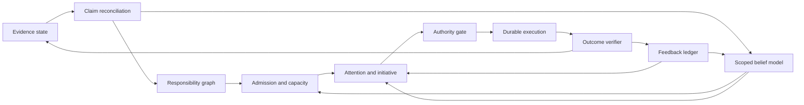

# Decision topology: dependencies, timing and guarantees

## Readiness and dependency ordering
- A decision is not safe if its evidence freshness is below the operation-specific threshold.
- Admissions and planning must check explicit personal constraints before suggesting new commitments.
- Attention has no right to grant authority; authorization belongs to independent policy.
- Side-effect verification produces new evidence. It cannot retroactively convert an LLM proposal into a completed external action.
- Learning can propose policy changes but must not self-deploy privileged actions.

## Timescales
Fast per-event state updates (milliseconds to seconds when services permit); context-sensitive coordination on material changes; nightly/periodic calibration on authorized historical samples; slower goal and policy reviews. These are design targets, not measured latencies.

## Explicit conflict-handling
- Source disagreement -> preserve both and seek provenance, not newest-timestamp wins.
- New scheduling need vs protected user time -> find constrained alternatives or request explicit change.
- Urgent item vs focused user -> compare last-safe-notification time with switch cost; critical guardrail wins where required.
- Efficiency vs user growth -> user chooses learning/practice delegation mode.
- Temporary behavior vs stated preference -> temporal scope and origin distinguish them.

## Central invariants
False completion is not acceptable; no ungranted side effects; no obsolete preference treated as current; no synthetic counterfactual claim without randomized exposure; no missing-response inference from stale connectors. State and decisions are traceable with version and evidence IDs.