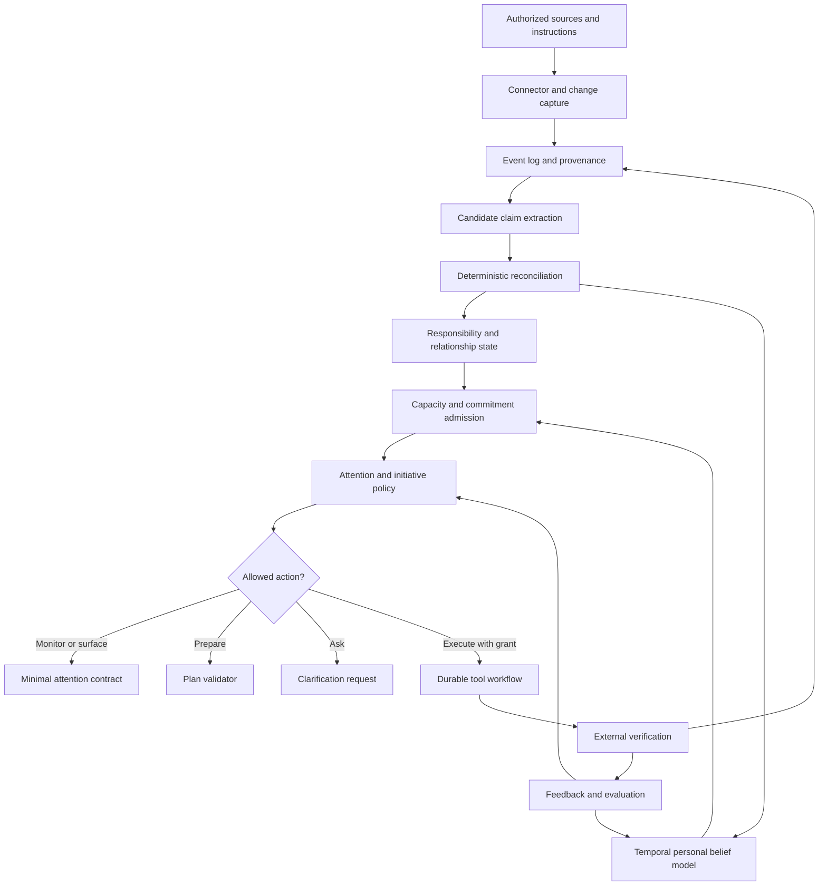

# System context and topology

## Logical architecture

## Processing loops
**Fast (per event):** deduplicate, reconcile evidence, check critical timers and side-effect completion; bounded deterministic rules.
**Coordination (on material changes):** commitments, feasibility, waiting states, interruption planning, low-risk proposals, conflict resolution.
**Adaptation (periodic and explicit corrections):** detect routine drift, revise scoped beliefs, calibrate durations and attention effectiveness; never change permissions implicitly.
**Governance (offline and release gates):** counterfactual evaluation, failure audits, protected-goal outcomes, privacy and access tests.

## Suggested deployment
Initial modular monolith: API + source sync workers + decision service + durable workflow workers; PostgreSQL transaction log/domain model; queue/outbox; object store for authorized source snapshots with retention; optional hybrid retrieval. Employ Temporal or equivalent for long-running effectful workflows only after basic transactional outbox and idempotency discipline.

Avoid graph database, specialized vector DB, microservices, multi-agent swarms, RL, or fine-tuning until measurements justify them.

## Boundaries
LLM: extraction, ambiguity resolution proposals, dialogue, drafting, tool-plan proposals.
Typed validators: evidence, identity, modality, temporal consistency, policy, deadlines.
Constraint solver: resource and time feasibility, not preference legitimacy.
Workflow runner: authorization, stateful execution, retries, verification.
Decision policy: select if/when/what/how much; not the same as generating text.

Related: [domain model](domain-model.md), [decision policy](../algorithms/attention-and-initiative.md), [execution](../workflows/execution-and-recovery.md).